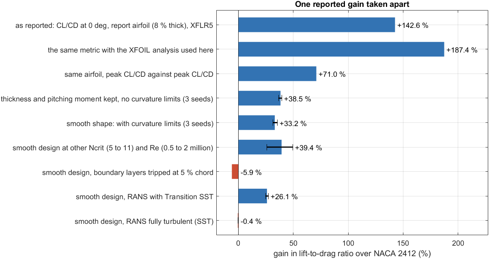
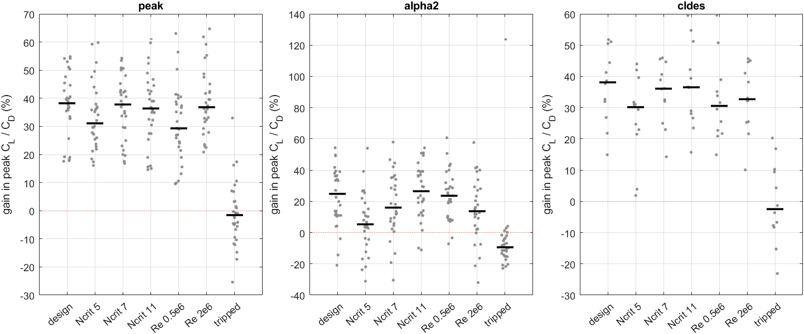

# The paper in one page: how much of an XFOIL-optimised airfoil gain is real?

This page explains the study behind this repository from the question to the answer, and how to present
it. Every number here is taken from a result document of the repository, where it is checked against the
result files by `tools/check_numbers.py`; the links lead to the details.

## The question

Optimising an airfoil with the panel code XFOIL inside the loop is cheap and very common, and papers
report gains in lift-to-drag ratio (CL/CD) of tens to hundreds of per cent. Such a number usually comes
from one optimisation run, at one angle of attack, with XFOIL's default assumption about where the
boundary layer turns turbulent (free transition, Ncrit = 9). **How much of such a gain is a property of
the airfoil, and how much comes from the way it was measured, from numerical artefacts and from the
assumption of laminar flow?**

## How it was answered

| Step | What | Where |
|---|---|---|
| 1 | Take one reported gain apart: the NACA 2412 optimisation of our own mini project | [results/paper](results/paper/README.md) |
| 2 | Repeat the analysis over 30 airfoils: 217 optimisations under several formulations and seeds, each design re-analysed at seven conditions | [results/population](results/population/README.md) |
| 3 | Check with an independent method: RANS (ANSYS Fluent), fully turbulent and with a transition model | [results/cfd](results/cfd/README.md) |
| 4 | Check both tools against measurements: NACA 0012 (Ladson 1988; NASA's reference codes) and the Eppler 387 with laminar separation bubbles (NASA TM-4062) | [results/validation](results/validation/README.md), [results/cfd](results/cfd/README.md) |
| 5 | Compare with what the literature reports, and propose a reporting checklist | [docs/literature.md](docs/literature.md) |

Tools: MATLAB (genetic algorithm followed by `fmincon`, CST shape with curvature limits), XFOIL at
Re = 10⁶, ANSYS Fluent 2026 R1 (student licence) with k-ω SST and Transition SST. Methods in detail:
[docs/methods.md](docs/methods.md).

## What was found

**1. The reported number depends mostly on how it is measured.** The mini project reported +142.6 % for
NACA 2412 (CL/CD at 0°, from XFLR5). The same airfoil, peak CL/CD against peak CL/CD, gains +71.0 %, and it
is a third thinner. With thickness and pitching moment kept and smooth shapes, +33.2 % remain. With the
boundary layers tripped the smooth design is −5.9 %; in RANS with a transition model it keeps +26.1 %
([gain decomposition](results/paper/README.md), figure `results/paper/gain_decomposition.png`).

**2. Over 30 airfoils the gain is a gain in laminar flow.** Optimised for peak CL/CD, the 30 airfoils
gain a median of 38.2 %. The median stays between 29.2 and 37.4 % at other Ncrit and Reynolds numbers,
but is −1.6 % with tripped boundary layers, where 19 of the 30 designs are worse than their original.

**3. The metric decides how large a gain looks.** Designs optimised at 2° gain a median of 49.1 % at 2°,
24.8 % in peak CL/CD and 2.4 % at the design lift coefficient. Whether a design is sensitive to Ncrit
also depends on the formulation: at the design lift, the designs optimised for peak CL/CD keep their
gain at Ncrit 5 (+24.9 and +24.7 %), while the designs optimised at that lift lose half of it (+31.0 and
+15.0 %).

**4. One run is not enough.** The three seeds of an airfoil end at peak CL/CD values whose range is a
median of 3.5 % of their mean; for 12 of the 30 airfoils it is more than 5 %.

**5. A formulation that keeps the gain.** Optimising the mean of the peak CL/CD with free transition and
with tripped boundary layers gives a median gain of 34.7 % over the 30 airfoils, and the design is
better than the single-point design with tripped flow for 29 of them, at a median cost of 2.4 points at
the design condition. (The two-condition mean is the construction of Caboni et al. 2018; using tripped
flow as the second condition, over 30 airfoils, is the new part.)

**6. RANS confirms the direction and shrinks the size.** With a transition model, the three NACA 2412
designs optimised for free transition gain 21.5 to 37.0 % over NACA 2412, against 36.1 to 76.3 % in
XFOIL; fully turbulent, they are 0.4 to 15.6 % below it, as tripped XFOIL predicts. The robust design is
3.3 % above NACA 2412 in fully turbulent flow and gains 17.1 % with the transition model.

**7. Both tools are checked against measurements.** Fluent's set-up is verified on NASA's NACA 0012 case
(lift within 1.2 %, drag within 6.4 % of NASA's three reference codes). On the Eppler 387 with laminar
separation bubbles, Fluent's lift is within 1.4 % and its mean drag 1.0 to 7.7 % low; XFOIL's lift is 2.6
to 9.8 % high and its drag 9.4 to 10.1 % low at every angle. Absolute XFOIL values are optimistic.

**8. XFOIL can produce false solutions, and an optimiser finds them.** XFOIL occasionally converges to
false low-drag solutions that exist only at one panelling or only at the exact design coordinates (a
tripped-flow CL/CD of 369 where the best original airfoil reaches 89.2). They steered 3 of the 217
optimisations. Two safeguards were added and validated: a friction floor using XFOIL's own transition
points, and every analysis at exact and rounded coordinates
([False XFOIL solutions](results/population/README.md#false-xfoil-solutions)).

**9. A cheaper optimiser that knows when not to trust itself (preliminary).** A neural-network
surrogate of XFOIL, trained on the population study, ranks the candidates; every kept design is analysed
with XFOIL. A trust check with limits from the training airfoils only decides whether the surrogate may
be used; if not, a closed-loop correction and then the usual XFOIL search take over. On six airfoils it
never saw, for the robust objective, it was trusted in 14 of 18 runs and then needed 4 to 22 times fewer
XFOIL analyses than the current optimiser for a similar or higher result; on S1223, outside the training
airfoils, it rejected itself and the fallback gave 128.3 against 125.7. With ten seeds, on NACA 2412 it
gives 107.5 ± 0.5 against 104.1 ± 2.8 with a twelfth of the XFOIL analyses (Mann-Whitney p = 0.0004); on
S1223 it falls back every time and is no worse (126.8 against 122.9, p = 0.19). At equal budget on NACA
2412 (free transition) it reaches 140.3 against 126.1 to 132.7 for GA, particle swarm and Bayesian
optimisation, and against Xoptfoil2 on the six airfoils it is level or ahead except where Xoptfoil2 breaks
the moment limit ([results/surrogate](results/surrogate/README.md)). The re-analysis of the final designs
with all safeguards is still running.

## What is new, and what is not

- **New:** one reported gain taken apart step by step; the same analysis over 30 airfoils with seeds,
  formulations and seven conditions; a RANS check of the gains with a transition model whose free-stream
  turbulence is matched to Ncrit, together with a fully turbulent bound (Adler et al. 2022 compare with
  fully turbulent RANS; Abouzoul et al. 2026 check morphing optima with Transition SST); the false-solution finding with two validated
  safeguards; a surrogate-assisted optimiser that verifies every kept design with XFOIL and checks
  whether its surrogate can be trusted for the airfoil, tested on airfoils it never saw (the literature
  check of this point is still open); a reporting checklist; open code in which every number is traceable.
- **Not new:** the GA → fmincon optimiser, surrogate-assisted optimisation as such (for example Khan et
  al. 2025), CST shapes, XFOIL, Transition SST, and the two-condition robust objective (Caboni et al. 2018). Robust laminar-flow design is studied by Hollom & Qin and others
  ([docs/literature.md](docs/literature.md)).

## Limits to state openly

- All optimisation is 2D, at Re = 10⁶ and M = 0, with XFOIL; RANS checks one airfoil family (NACA 2412)
  in detail, not all 30.
- Transition SST runs on these airfoils cycle instead of settling; they are reported as means over whole
  cycles, and one time-accurate run confirms those means. Different RANS codes with the same transition
  model do not agree within their uncertainty (Eça et al. 2022), so the Fluent numbers are those of one
  implementation.
- The Ncrit conditions are discrete values (5, 7, 11), and "tripped" means transition fixed at 5 % chord;
  neither is a measured roughness.
- No wind-tunnel test of an optimised design.

## Where everything is

| Folder | Content |
|---|---|
| [MATLAB/](MATLAB/README.md) | all code: optimiser (`Optimization`), XFOIL interface (`Aerodynamics`), studies of the paper (`Paper`), CFD mesh, journals and post-processing (`CFD`), morphing, validation |
| [results/](results/README.md) | every result with its README: `paper` (NACA 2412 taken apart), `population` (30 airfoils), `cfd` (Fluent), `surrogate` (surrogate-assisted optimiser), `validation` (XFOIL against wind-tunnel data), earlier studies |
| [docs/](docs/) | `methods.md` (how everything was done), `literature.md` (search, audit, research gaps, checklist), `paper_outline.md` (structure of the manuscript, figures and tables) |
| [tools/](tools/) | `check_numbers.py` and its manifest: every number in the documents against its source file |
| [README.md](README.md) | the project from the mini project onwards, and how to run the code |

## How to explain it

### In two minutes

1. "Airfoil optimisation with XFOIL is everywhere, and papers report big gains. We asked how much of
   such a gain is real."
2. "Our own mini project said +142.6 % for NACA 2412. Measured fairly, peak against peak, it is +71 %;
   with the thickness kept and a smooth shape, +33 %; and if the boundary layer is turbulent from the
   start, the gain is gone."
3. "We repeated this for 30 airfoils with 217 optimisations: the median gain is about 38 %, it survives
   changes of turbulence level and Reynolds number, but with tripped boundary layers it is −1.6 % and
   19 of 30 designs are worse than the original. The gain is a laminar-flow gain."
4. "If the optimiser also sees the tripped case, it keeps most of the gain and stays above the original
   with tripped flow for most airfoils."
5. "RANS with a transition model confirms the gains but makes them smaller, and both tools are checked
   against NASA measurements. Along the way we found that XFOIL sometimes gives false low-drag solutions
   that an optimiser exploits, and we added two checks against them."
6. "Finally, the optimiser itself: a surrogate trained on these runs gets the same result with far fewer
   XFOIL analyses, and it detects the airfoils for which it cannot be trusted."

### In ten minutes: the order of the figures

1. **The problem:** the mini-project result (+142.6 %) and why it is suspicious.
   Figure: `results/xfoil/designs.png`, `results/xfoil/polars.png`.
2. **One gain taken apart:** the bar chart `results/paper/gain_decomposition.png`; walk down the bars.
3. **30 airfoils:** `results/population/gains_by_condition.png`; point at the tripped column.
4. **The metric:** `results/population/gain_by_angle.png`; the gain depends on the angle at which it is
   reported.
5. **The robust formulation:** the paired table in `results/population/README.md`
   ("Free and tripped flow together").
6. **RANS:** `results/cfd/designs/design_polars.png`; same direction, smaller size.
7. **Validation:** `results/cfd/e387/e387_validation.png` and the NACA 0012 verification in
   `results/cfd/verification`.
8. **False XFOIL solutions:** the table in the population README; one example (369 against 89.2).
9. **The surrogate optimiser:** the result table in `results/surrogate/README.md`; trusted runs, then S1223.
10. **The checklist:** section 13 of `docs/literature.md`.

### Questions to expect

- **"Why not optimise with RANS directly?"** Too expensive on a laptop for 217 optimisations; RANS is used
  where it decides the question: as an independent check of the gains. Adler et al. (2022) compare XFOIL
  with fully turbulent RANS optimisation; here the check uses a transition model with the turbulence
  matched to XFOIL's Ncrit, and the fully turbulent case as a bound.
- **"Is fixed transition at 5 % chord realistic?"** It is a bound: fully turbulent flow, as on a rough or
  contaminated wing. The truth for a real wing lies between free and tripped; showing both is the point.
- **"Why should we trust Fluent?"** It is verified on NASA's NACA 0012 case (lift within 1.2 %, drag
  within 6.4 %) and validated on the Eppler 387 against measurements; its limits (cycling runs, code-to-
  code spread of the transition model) are stated.
- **"How do you know the XFOIL results are not artefacts?"** Curvature limits, a laminar and a friction
  floor, two panellings, exact and rounded coordinates, at least 12 converged angles; the false
  solutions that remained were found by these checks and the affected runs repeated.
- **"What is the contribution, if the methods are known?"** The systematic separation of a reported gain
  into its parts, over 30 airfoils, with an independent RANS check and a checklist that others can apply.
- **"What are the weaknesses?"** See [Limits to state openly](#limits-to-state-openly).

## State

All computations are finished; the results are final and published in this repository. The manuscript
is the next step: scope (with or without the morphing studies), format and target journal are open
([docs/paper_outline.md](docs/paper_outline.md)).
