# CFD results (ANSYS Fluent)

The RANS runs check the XFOIL results with an independent method. This folder has six parts:

| Folder | Contents | State |
|---|---|---|
| [timestep_study](timestep_study) | which solver settings give a steady solution | done |
| [verification](verification) | the set-up against NASA's NACA 0012 case | done |
| [e387](e387) | Fluent and XFOIL against wind-tunnel measurements with laminar separation bubbles | done |
| [designs](designs) | the NACA 2412 designs with Transition SST and SST | done |
| [transition_tests](transition_tests) | solver settings tried for the Transition SST runs | done |
| [time_accurate](time_accurate) | NACA 2412 at 4° with the transition model in physical time | done |

All files are written by `MATLAB/CFD/collect_cfd_results.m` from the outputs of `timestep_study.m`,
`verify_naca0012.m`, `validate_e387.m`, `run_design_study.m`, `transition_tests.m` and `run_time_accurate.m`. The Fluent transcripts are not
published, because they contain local paths.

## Verification on NASA's NACA 0012 case

**Case.** 2D NACA 0012 validation case of the NASA Turbulence Modeling Resource: k-ω SST, M = 0.15,
Re = 6 × 10⁶, free-stream turbulence 0.052 % with viscosity ratio 0.009. NASA lists results of three
codes (CFL3D, FUN3D, NTS) on one 897 × 257 grid and notes that they agree within 1 % in lift and 5 % in
drag, and that the results are "representative, but not truth".

**Our runs.** Three geometrically similar meshes (refinement ratio √2) with the far field 500 chords
away: 50,292, 100,240 and 200,376 cells. Fixed pseudo-time step of one chord passage, 400 first-order and
3000 second-order iterations. All runs below are steady: over the last 500 iterations CL varies by less
than 0.0001 and CD by less than 0.00001.

| α | | Coarse | Medium | Fine | CFL3D | FUN3D | NTS |
|---|---|---:|---:|---:|---:|---:|---:|
| 0° | CD | 0.00807 | 0.00812 | 0.00814 | 0.00809 | 0.00808 | 0.00809 |
| 10° | CL | 1.0747 | 1.0757 | 1.0749 | 1.0778 | 1.0840 | 1.0765 |
| 10° | CD | 0.01307 | 0.01284 | 0.01274 | 0.01236 | 0.01253 | 0.01251 |
| 15° | CL | not steady | 1.4955 | 1.4925 | 1.5068 | 1.5109 | 1.5100 |
| 15° | CD | not steady | 0.02339 | 0.02326 | 0.02219 | 0.02275 | 0.02187 |

- **Lift** on the fine mesh is 0.1 to 0.8 % below the three codes at 10° and 0.9 to 1.2 % below them at 15°.
- **Drag** on the fine mesh is 0.7 to 0.8 % above them at 0°, 1.7 to 3.1 % above at 10° and 2.3 to 6.4 %
  above at 15°. The three codes themselves differ by up to 4 % at 15°.
- **The medium mesh**, whose resolution the design study uses, is 2.4 to 3.9 % above the three codes in
  drag at 10°.
- **On the coarse mesh the 15° case does not reach a steady state**; it falls onto a stalled solution.

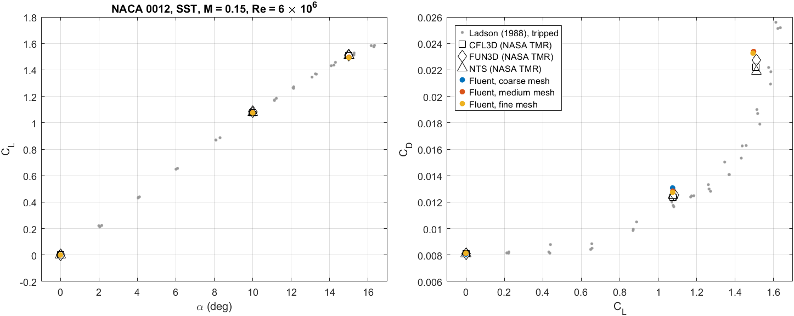

**Pressure and skin friction** ([surface_comparison.csv](verification/surface_comparison.csv)). On the
medium mesh the skin friction on the upper surface differs from CFL3D's by 0.6 %, 0.4 % and 0.7 % of its
mean value at 0°, 10° and 15° (between 5 % and 95 % chord). The suction peak at 10° is −5.576 against
−5.604.

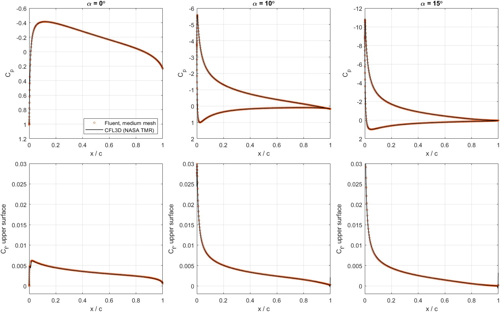

**Mesh convergence** ([grid_convergence.csv](verification/grid_convergence.csv); procedure of Celik et
al. 2008).

| α | Quantity | Apparent order | Extrapolated | Uncertainty, fine mesh | Uncertainty, medium mesh |
|---|---|---:|---:|---:|---:|
| 0° | CD | 2.4 | 0.00816 | 0.28 % | 0.64 % |
| 10° | CD | 2.6 | 0.01267 | 0.67 % | 1.61 % |

The lift at 10° changes by less than 0.1 % between the meshes and not monotonically, so no order is
given for it. At 15° only two meshes give a steady solution; the medium mesh is 0.6 % above the fine one
in drag.

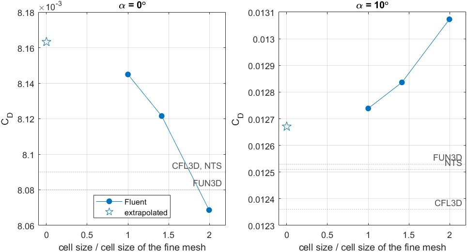

**Domain size** ([farfield.csv](verification/farfield.csv)). With the resolution of the medium mesh at
10°, a far field 20 chords away raises the drag by 9.4 % and lowers the lift by 0.5 %; at 100 chords
the drag is still 1.5 % too high. The error falls roughly in proportion to the distance, which leaves
about 0.3 % at 500 chords. It grows with lift, so a small domain would penalise exactly the designs that
carry more lift.

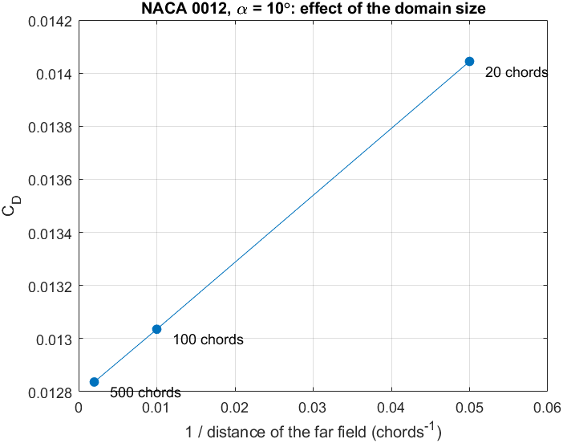

## Validation against measurements: Eppler 387 at Re = 300 000

The NACA 0012 case checks the fully turbulent set-up. The designs, however, owe their gain to laminar
flow, so both tools are also compared with a measurement in which laminar separation bubbles decide the
drag: the Eppler 387 in the Langley Low-Turbulence Pressure Tunnel (McGhee, Walker & Millard 1988, NASA
TM-4062), Re = 300 000, M = 0.09. The report gives the forces (lift from surface pressures, drag from wake
surveys, drag uncertainty about 2 counts) and, from oil flow, where the laminar layer separates and where
the turbulent layer reattaches ([reference_ltpt.csv](e387/reference_ltpt.csv),
[source](e387/README_source.txt)).

**Set-up** (`validate_e387.m`). Fluent with Transition SST and exactly the settings of the design study:
the same C-grid generator (100,240 cells, far field 500 chords away), 400 first-order and 5000
second-order iterations, means over the last 2400. The free-stream turbulence decays to 0.060 % at the
airfoil, the level of the tunnel. XFOIL with free transition at Ncrit 9 (Mack's relation gives 9.4 for
0.06 %), M = 0.09, 160 panel nodes.

| α | CL measured | CL Fluent | CL XFOIL | CD measured | CD Fluent (lowest to highest) | CD XFOIL |
|---|---:|---:|---:|---:|---:|---:|
| 0° | 0.352 | 0.353 (+0.4 %) | 0.386 (+9.8 %) | 0.00883 | 0.00840 (0.00726 to 0.01063), −4.9 % | 0.00800 (−9.4 %) |
| 2° | 0.573 | 0.579 (+1.0 %) | 0.607 (+5.9 %) | 0.00990 | 0.00980 (0.00853 to 0.01314), −1.0 % | 0.00891 (−10.0 %) |
| 4° | 0.792 | 0.803 (+1.4 %) | 0.826 (+4.2 %) | 0.01090 | 0.01006 (0.00951 to 0.01057), −7.7 % | 0.00980 (−10.1 %) |
| 6° | 1.009 | 1.015 (+0.6 %) | 1.035 (+2.6 %) | 0.01170 | 0.01131 (0.01127 to 0.01136), −3.3 % | 0.01057 (−9.7 %) |

Upper surface, x/c ([comparison.csv](e387/comparison.csv)):

| α | Separation, oil flow | Separation, Fluent | Reattachment, oil flow | Reattachment, Fluent | Transition, XFOIL |
|---|---:|---:|---:|---:|---:|
| 0° | 0.48 | 0.486 | 0.69 | none (reversed flow to 0.95) | 0.684 |
| 2° | 0.45 | 0.456 | 0.62 | none (reversed flow to 0.91) | 0.636 |
| 4° | 0.40 | 0.411 | 0.58 | 0.656 | 0.580 |
| 6° | 0.38 | 0.366 | 0.50 | 0.554 | 0.466 |

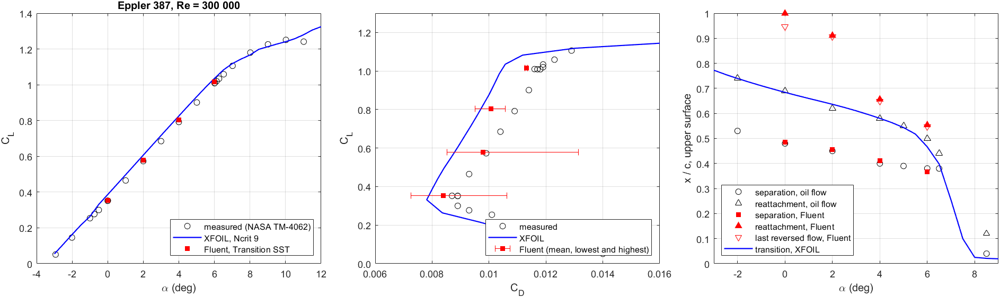

- **Lift.** Fluent is within 1.4 % of the measurement at all four angles; XFOIL is 2.6 to 9.8 % high, most
  at small angles.
- **Drag.** XFOIL is 9.4 to 10.1 % low at every angle, a nearly constant offset. Fluent's mean is 1.0 to
  7.7 % low.
- **Where the laminar layer separates,** Fluent is within 0.014 c of the oil flow at every angle.
- **Where the bubble closes,** XFOIL's transition point is within 0.034 c of the measured reattachment.
  In Fluent the bubble closes 0.05 to 0.08 c too far aft at 4° and 6°. At 0° and 2° it sheds vortices: the
  forces do not settle (CL varies by 0.08 over the last 2400 iterations, hence the wide drag range), and
  the mean skin friction changes sign several times aft of 0.5 c without staying positive over 0.05 c
  before the trailing edge. Reattachment is taken as the first point after separation from which the
  mean skin friction stays positive over 0.05 c.
- **What this means for the results.** Both tools predict too little drag for a flow with laminar
  separation bubbles, XFOIL by a nearly constant 10 %. A constant offset largely cancels in a gain taken
  against the original airfoil at the same condition, but a design with a different bubble can be
  affected differently, which is why the gains are checked with Fluent.

## Which solver settings give a steady solution

Fluent's pressure-based coupled solver advances in pseudo-time. Its automatic time step is tied to the
size of the domain, so it is very large for a 500-chord domain. `timestep_study.m` compares it with a
fixed step of one chord passage ([forces.csv](timestep_study/forces.csv)).

| Case | Automatic step | Fixed step (one chord passage) |
|---|---|---|
| 10°, coarse mesh | CD 0.01307, steady | CD 0.01307, steady |
| 10°, medium mesh | CD 0.01284, steady | CD 0.01284, steady |
| 10°, fine mesh | not steady: CD varies by 0.0039 over the last 500 iterations | CD 0.01274, steady |
| 15°, medium mesh, started directly | stalled: CL 0.69, CD 0.28 | CL 1.4955, CD 0.02339, steady |
| 15°, medium mesh, reached from 10° in steps | CL 1.4954, CD 0.02339, steady | not settled after 1500 iterations per angle |

- **Where both settings converge, they give the same forces.**
- **The differentiable slope limiter does not help:** the fine mesh with the automatic step stays unsteady.
- **Mach 0.1 converges with the fixed step** (CD 0.00812 at 0°). With the automatic step it had diverged.

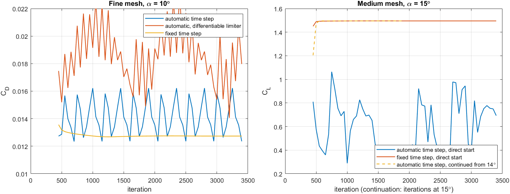

## Design study

Six airfoils at Re = 10⁶ and M = 0.15 (`MATLAB/CFD/designStudyAirfoils.m`): NACA 2412; three designs
optimised for the peak CL/CD with free transition (the smooth and the wavy design of `results/paper` and
the earlier PARSEC design); and two designs optimised for free and tripped flow together
(`results/population`).

**XFOIL at the same condition** ([designs/xfoil.csv](designs/xfoil.csv)), best CL/CD between −2° and 12°:

| Airfoil | Free transition, Ncrit 9 | Tripped at 5 % chord |
|---|---:|---:|
| NACA 2412 | 104.2 | 72.6 |
| optimised, smooth | 140.7 | 68.3 |
| optimised, no curvature limits | 146.0 | 70.1 |
| PARSEC design | 182.1 | 53.2 |
| optimised for free and tripped flow (mean) | 138.1 | 74.5 |
| optimised for the worse of free and tripped | 103.4 | 77.4 |

- **With tripped boundary layers the three designs optimised for free transition alone are worse than
  the original.** Their gain comes from laminar flow.
- **The two designs that had the tripped condition in their objective are not.** The first keeps almost
  the whole free-transition gain; the second gives it up for the best tripped value.
- **The Mach number matters little:** at M = 0 the free-transition values of the first four are 104.6,
  141.6, 145.9 and 182.5.

**Fluent, start-up check.** The first run repeats the NASA case with the start-up of the design study and
gives the same forces as the
verification (CL 1.0757, CD 0.01284).

**How the batch ran.** In two parts with identical Fluent journals: the first 22 runs from commit 3642e57,
the others from commit 2101fb6 ([designs/run_info.json](designs/run_info.json)). The restart was forced by
the machine running out of memory during one Transition SST run; that run was repeated in full.

### Fully turbulent flow (SST)

All six airfoils at 0° to 10° (36 runs, all steady). CL/CD from Fluent, and in brackets from XFOIL with
the boundary layers tripped at 5 % chord ([designs/comparison.csv](designs/comparison.csv)):

| Airfoil | 0° | 2° | 4° | 6° | 8° | 10° |
|---|---:|---:|---:|---:|---:|---:|
| NACA 2412 | 18.8 (18.6) | 36.8 (36.9) | 51.4 (52.6) | 61.3 (64.7) | 65.8 (72.0) | 64.8 (68.5) |
| optimised, smooth | 32.2 (32.0) | 47.8 (47.7) | 59.2 (59.9) | 65.3 (67.2) | 65.5 (68.0) | 59.1 (58.9) |
| optimised, no curvature limits | 28.1 (28.0) | 44.8 (45.0) | 57.3 (58.5) | 64.4 (67.4) | 65.3 (69.7) | 58.5 (57.1) |
| PARSEC design | 35.2 (28.7) | 46.9 (39.2) | 53.7 (46.7) | 55.5 (51.4) | 53.5 (53.1) | 49.0 (52.3) |
| optimised for free and tripped flow (mean) | 29.2 (29.4) | 46.0 (46.6) | 58.7 (60.4) | 66.3 (70.1) | 67.9 (74.5) | 63.1 (65.4) |
| optimised for the worse of free and tripped | 19.3 (19.1) | 37.3 (37.5) | 51.9 (53.3) | 61.9 (65.5) | 66.7 (73.7) | 66.4 (77.2) |

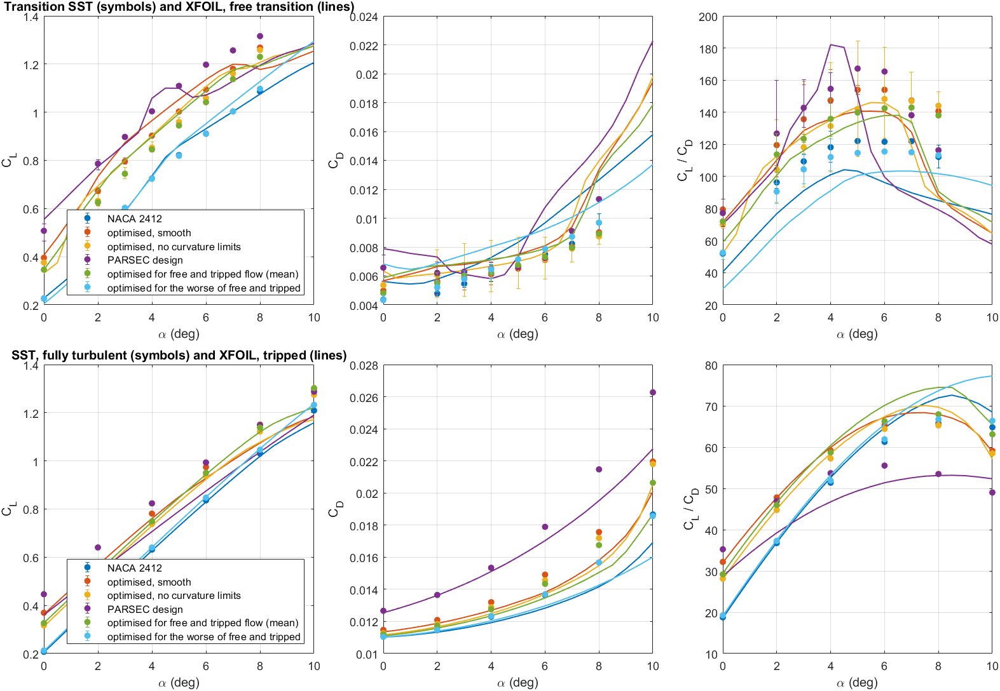

- **Without laminar flow the designs optimised for free transition alone have no advantage.** The best
  CL/CD over these angles is 65.8 for NACA 2412, 65.5 and 65.3 for the two CST designs (0.4 % and 0.8 %
  lower) and 55.5 for the PARSEC design (15.6 % lower) ([designs/peaks.csv](designs/peaks.csv)). XFOIL
  with tripped boundary layers puts these three designs 5.6 %, 3.2 % and 26.2 % below the original at
  the same angles. Both methods put the PARSEC design far behind; Fluent sees a smaller loss for the CST
  designs.
- **The design optimised for free and tripped flow together is better than the original here as well:**
  67.9, which is 3.3 % higher; XFOIL had given 3.5 %. The design optimised for the worse of the two
  conditions reaches 66.7 (1.5 % higher; XFOIL: 7.4 %).
- **At a fixed small angle the designs look better even here.** At 4° the five designs reach 51.9 to
  59.2 against 51.4, mostly because they carry more lift at the same angle.
- **Fluent and tripped XFOIL agree closely at low lift.** Leaving the PARSEC design aside, Fluent's drag
  is higher than XFOIL's by 0.2 to 1.1 % at 0°, by 9.9 to 11.3 % at 8° and by 6.3 to 16.0 % at 10°, and
  its lift differs by −0.4 to +9.7 %. For the PARSEC design Fluent's lift is 8.1 to 23.9 % higher.
- **The peak lies inside the range of the runs:** every airfoil has its best value at 6° or 8° and a
  lower one at 10°.
- **Mesh.** NACA 2412 at 4° on the refined mesh (200,376 cells) gives a drag that differs by 0.03 % from
  the mesh of the design study ([designs/mesh_check.csv](designs/mesh_check.csv)).

### Transition SST

All six airfoils at 0° to 8° (48 runs), and NACA 2412 at 4° on the refined mesh.

**The runs do not settle.** Lift and drag cycle, for NACA 2412 with a period of 2550 iterations
([designs/history.csv](designs/history.csv), [designs/cycle_naca2412_a4.csv](designs/cycle_naca2412_a4.csv)):

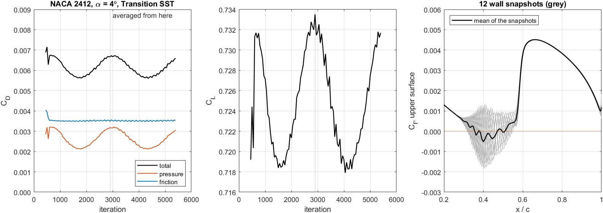

- **What cycles.** The drag moves between 0.00561 and 0.00673 and the lift between 0.7179 and 0.7335.
  The friction part of the drag stays at 0.0035; the whole change is in the pressure part (0.0021 to
  0.0031 in the wall snapshots).
- **Why.** The laminar boundary layer of the upper surface separates near one third of the chord. In
  every snapshot the separated region is not one bubble but a train of small separation cells, with
  reversed flow starting between x/c = 0.32 and 0.35 and ending between 0.51 and 0.54. The train drifts
  from one iteration to the next, and the forces follow it. On the lower surface the laminar layer
  separates at x/c = 0.89 to 0.91 and stays separated to the trailing edge.
- **What is reported.** The forces are means over whole cycles, with the lowest and the highest value in
  the cycle, and the surface data are means over the 12 snapshots of a run. The mean skin friction of
  the upper surface is close to zero from the separation to x/c = 0.57 and then rises steeply; the
  middle of the rise, taken as the transition location, is at 0.582.
- **Against XFOIL** (free transition, Ncrit 9, same angle): CL 0.7249 against 0.7356, CD 0.00613 against
  0.00728, CL/CD 118.2 (108.6 to 128.2 within the cycle) against 101.0. XFOIL has transition on the upper
  surface at x/c = 0.38, Fluent at 0.58: the transition model keeps the separated layer laminar for
  much longer, and its drag is 15.7 % lower.
- **Inflow.** The turbulence intensity one chord ahead of the airfoil is 0.0717 %, which corresponds to
  Ncrit = 8.95 by Mack's relation.

**Solver settings do not remove the cycle.** `MATLAB/CFD/transition_tests.m` repeats NACA 2412 at 4° with
five settings, 4000 second-order iterations each ([transition_tests/forces.csv](transition_tests/forces.csv)):

| Setting | Mean CD | CD, lowest to highest | CL/CD |
|---|---:|---:|---:|
| S: the settings of the design study | 0.00617 | 0.00561 to 0.00673 | 117.5 |
| R: relaxation factor 0.3 for the two transition equations | 0.00619 | 0.00564 to 0.00672 | 117.3 |
| U: first-order upwinding for the two transition equations | 0.00650 | 0.00626 to 0.00672 | 111.8 |
| O: pseudo-time step of one chord passage from the start | 0.00633 | 0.00582 to 0.00675 | 115.1 |
| A: Fluent's automatic pseudo-time step | 0.00626 | 0.00556 to 0.00696 | 115.8 |

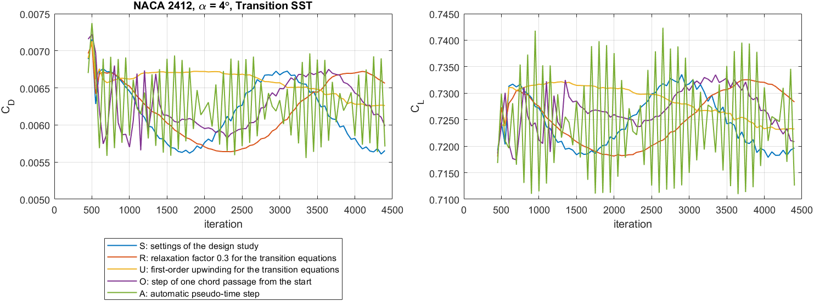

None of the five runs is steady. The mean drag lies between 0.00617 and 0.00650. First-order upwinding
gives the smallest swing and the highest mean, and its drag is still drifting at the end of the run.

**The mesh does not remove it either.** On the mesh refined by √2 in both directions the same case cycles
with a period of 3350 iterations instead of 2550. Its mean drag is 0.00620 against 0.00613 on the mesh of
the design study (1.0 % apart), its CL/CD 117.1 against 118.2, and its transition location 0.569 against
0.582 ([designs/mesh_check.csv](designs/mesh_check.csv)).

**In physical time the same case gives the same mean forces.** `MATLAB/CFD/run_time_accurate.m` repeats
the first 2400 iterations of the run above and continues from there time-accurately: 8000 time steps of
0.001 chord passages (8 chord passages), bounded second-order implicit, at most 10 iterations per time
step. The first part reproduces the 41 force reports of the design-study run exactly. The means are taken
over the last 4 chord passages ([time_accurate/summary.csv](time_accurate/summary.csv),
[time_accurate/run.csv](time_accurate/run.csv)):

| | Pseudo-time, mean over whole cycles | Time-accurate, mean over 4 chord passages | Difference |
|---|---:|---:|---:|
| CL | 0.7249 | 0.7282 | +0.5 % |
| CD | 0.00613 | 0.00615 | +0.2 % |
| CL/CD | 118.2 | 118.5 | +0.3 % |
| CD, lowest to highest | 0.00561 to 0.00673 | 0.00542 to 0.00672 | |
| Pressure part of CD | 0.00262 | 0.00277 | +5.7 % |
| Friction part of CD | 0.00352 | 0.00338 | −4.0 % |
| Transition on the upper surface, x/c | 0.582 | 0.624 | |

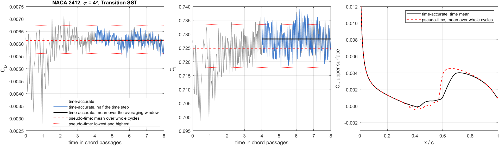

- **The flow is unsteady in physical time too.** Lift and drag keep oscillating; the largest line of the
  lift spectrum is at 15.75 cycles per chord passage, which is 63 time steps per cycle. At the last time
  step the upper surface carries 8 reversed-flow cells between x/c = 0.35 and 0.64, and over the last 39
  time steps their pattern moves downstream by 0.0115 chords, about 0.29 of the free-stream speed. The
  cells that drift slowly from iteration to iteration in pseudo-time are travelling cells.
- **The mean forces agree within 0.5 %,** and the drag swings over almost the same range. The two parts
  of the drag differ more and in opposite directions: in physical time the mean skin friction rises
  later and more gradually behind the separated region, so the friction part is lower and the pressure
  part higher.
- **How well the time mean is known.** Within the averaging window the means over single chord passages
  lie between 0.00604 and 0.00627 in drag, 3.8 % apart, so the agreement of 0.2 % is closer than a run of
  this length can establish. The first 4 chord passages are left out; in them the solution leaves the
  pseudo-time state, and the drag falls as low as 0.0028.
- **Numerical quality.** Within a time step the residuals fall by 2.6 to 5.1 orders of magnitude (medians
  over the averaging window). One mesh and one angle were run.
- **The time step is small enough.** The averaging window was repeated with half the time step, from the
  saved state after 4 chord passages (8000 time steps of 0.0005 chord passages). The mean drag changes by
  0.02 % and the mean lift by 0.002 %, the means over single chord passages differ by at most 0.09 % of
  the mean drag, and the largest line of the lift spectrum stays at 15.75 cycles per chord passage. In
  the figure the two histories lie on top of each other.

For this case the mean over whole pseudo-time cycles is therefore a fair estimate of the time mean of the
model. The run does not say which model is closer to a measurement.

**The six airfoils at 4°** (means over whole cycles; [designs/forces.csv](designs/forces.csv),
[designs/comparison.csv](designs/comparison.csv)):

| Airfoil | Period (iterations) | CL | CD | CL/CD, mean (lowest to highest) | XFOIL CL/CD | Transition, upper surface: Fluent / XFOIL |
|---|---:|---:|---:|---:|---:|---:|
| NACA 2412 | 2550 | 0.7249 | 0.00613 | 118.2 (108.6 to 128.2) | 101.0 | 0.58 / 0.38 |
| optimised, smooth | 450 | 0.9026 | 0.00612 | 147.4 (130.5 to 166.7) | 135.7 | 0.75 / 0.50 |
| optimised, no curvature limits | 400 | 0.8530 | 0.00649 | 131.4 (103.6 to 171.0) | 135.3 \* | 0.68 / 0.50 |
| PARSEC design | 1250 | 1.0037 | 0.00649 | 154.6 (145.7 to 164.7) | 182.1 | 0.77 / 0.70 |
| optimised for free and tripped flow (mean) | 2800 | 0.8454 | 0.00622 | 135.8 (125.1 to 148.5) | 125.6 | 0.71 / 0.45 |
| optimised for the worse of free and tripped | 1050 | 0.7235 | 0.00646 | 112.0 (102.7 to 123.3) | 91.1 | 0.59 / 0.27 |

\* XFOIL did not converge at 4° for this airfoil; the value is the mean of 3.5° and 4.5°.

The transition location is the middle of the rise of the mean skin friction
(`MATLAB/CFD/transitionFromCf.m`).

**All angles.** CL/CD as means over whole cycles, and in brackets XFOIL with free transition at Ncrit 9
([designs/comparison.csv](designs/comparison.csv)):

| Airfoil | 0° | 2° | 3° | 4° | 5° | 6° | 7° | 8° |
|---|---:|---:|---:|---:|---:|---:|---:|---:|
| NACA 2412 | 51.9 (40.5) | 96.3 (76.7) | 109.4 (91.1) | 118.2 (101.0) | 122.1 (103.3) | 121.6 (96.2) | 121.9 (89.8) | 112.1 (85.0) |
| optimised, smooth | 79.4 (71.6) | 119.5 (110.2) | 135.6 (128.5) | 147.4 (135.7) | 153.9 (140.6) | 153.9 (140.4) | 147.3 (127.6) | 140.6 (88.1) |
| optimised, no curvature limits | 70.0 (52.2) | 104.4 (112.5) | 118.2 (125.2) | 131.4 (135.3) | 142.0 (143.3) | 148.2 (145.7) | 146.9 (118.8) | 144.0 (86.5) |
| PARSEC design | 77.2 (70.3) | 126.7 (106.0) | 142.7 (141.8) | 154.6 (182.1) | 167.2 (150.0) | 165.3 (99.6) | 138.1 (87.2) | 116.3 (79.2) |
| optimised for free and tripped flow (mean) | 71.9 (58.9) | 113.7 (100.6) | 123.4 (116.1) | 135.8 (125.6) | 139.8 (133.6) | 142.4 (137.9) | 142.9 (133.9) | 138.0 (90.6) |
| optimised for the worse of free and tripped | 52.5 (29.9) | 90.6 (64.3) | 104.4 (78.6) | 112.0 (91.1) | 114.6 (100.5) | 115.5 (103.1) | 115.0 (103.3) | 113.2 (101.7) |

Two XFOIL values are means of the neighbouring angles, because XFOIL did not converge at the angle itself
(4° for the design without curvature limits, 7° for the PARSEC design).

**Best CL/CD over these angles** ([designs/peaks.csv](designs/peaks.csv)):

| Airfoil | Fluent, Transition SST | Gain over NACA 2412 | XFOIL at the same angles | Gain over NACA 2412 |
|---|---:|---:|---:|---:|
| NACA 2412 | 122.1 at 5° | | 103.3 | |
| optimised, smooth | 153.9 at 6° | +26.1 % | 140.6 | +36.1 % |
| optimised, no curvature limits | 148.2 at 6° | +21.5 % | 145.7 | +41.1 % |
| PARSEC design | 167.2 at 5° | +37.0 % | 182.1 | +76.3 % |
| optimised for free and tripped flow (mean) | 142.9 at 7° | +17.1 % | 137.9 | +33.5 % |
| optimised for the worse of free and tripped | 115.5 at 6° | −5.4 % | 103.3 | 0.0 % |

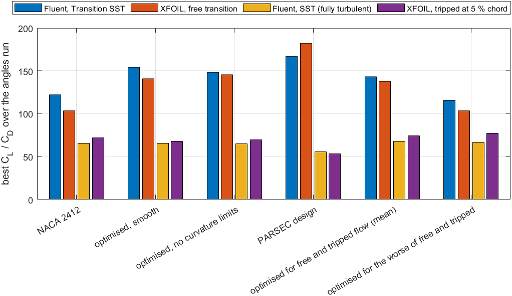

- **The transition model confirms the gains of the designs at about half to three quarters of the size
  that XFOIL gives.** The three designs optimised for free transition alone gain 21.5 to 37.0 % over
  NACA 2412, against 36.1 to 76.3 % in XFOIL.
- **The gains are smaller because Fluent rates the original higher.** Its CL/CD for NACA 2412 is 16.9 to
  35.8 % above XFOIL's over these angles. In all 48 runs it has transition on the upper surface further
  aft than XFOIL, by 0.05 to 0.48 chords, so every airfoil has more laminar flow, and the original
  profits most.
- **The design optimised for free and tripped flow together is the only one that is ahead of NACA 2412
  with both models:** 17.1 % with the transition model and 3.3 % in fully turbulent flow. The designs
  optimised for free transition alone gain more with the transition model and lose 0.4 to 15.6 % in fully
  turbulent flow.
- **How strongly the runs cycle depends on the angle.** Only one of the 48 runs meets the criterion for a
  steady solution. A period was found in 28, between 400 and 3350 iterations. The drag swings most at 2°
  to 4°; at 5° to 7° it varies by less than 4 % of its mean for every airfoil except the design without
  curvature limits, which swings by up to 58 %. The mean over whole cycles differs by at most 0.89 % in
  drag from the mean over all second-order iterations after the first 600, so the choice of the window
  matters little.

**Which model is closer to a measurement cannot be decided here,** because there is no measurement at
this condition. Two things speak for caution with the transition model: XFOIL's own drag with free
transition is already below the wind-tunnel data for NACA 0012 ([validation](../validation/README.md)), and
the transition model predicts less drag still; and Eça et al. (2022) found for the Eppler 387 airfoil
that this model gave the largest separation bubble and the largest difference from the experiment
(`docs/literature.md`). What the comparison does show is that the size of the gain depends strongly on
the transition model.
