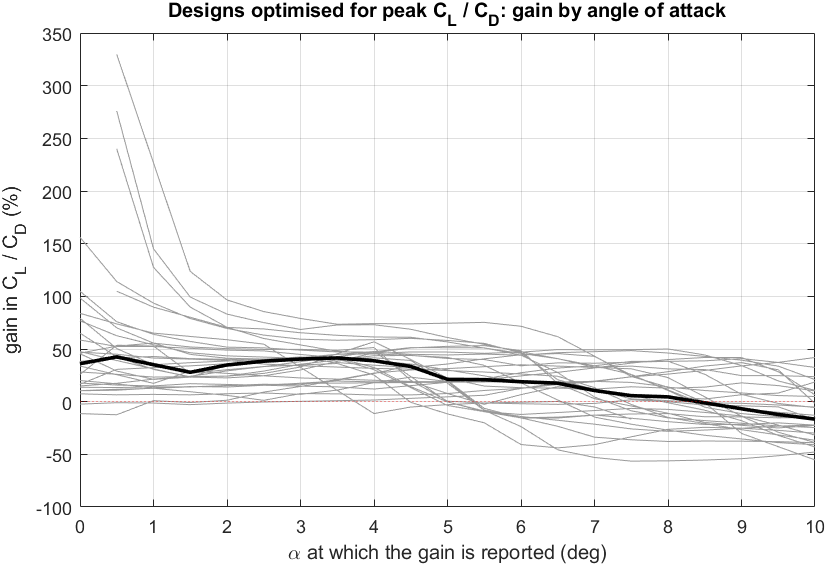

# Population study

**State: final, 217 of 217 runs.** The batch (`MATLAB/Paper/run_population_study.m`) optimises 30 baseline
airfoils under several formulations. The tables in this folder are written by
`MATLAB/Paper/collect_population_results.m`; `sensitivity.csv` and `cst_coefficients.csv` by
`MATLAB/Paper/xfoil_sensitivity_check.m`.

| Formulation | Objective | Runs |
|---|---|---|
| `peak` | peak CL/CD | 30 airfoils, seeds 1 to 3 (90 runs) |
| `alpha2` | CL/CD at 2° | 30 airfoils |
| `cldes` | CL/CD at the lift coefficient where the original has its peak | 30 airfoils |
| `nocurv` | peak CL/CD without curvature limits | 30 airfoils |
| `robusttrip` | mean of the peak CL/CD with free transition and with tripped boundary layers | 30 airfoils (NACA 2412 with seeds 1 to 3) |
| other robust formulations | NACA 2412 only, see below | 5 runs |

Settings of every run: XFOIL at Re = 10⁶ and M = 0, CST shape with 14 design variables (order 6),
genetic algorithm followed by `fmincon`, limits on thickness, pitching moment and curvature
(`docs/methods.md`). Each design is then analysed with 160 panel nodes at the design condition (Ncrit 9),
at Ncrit 5, 7 and 11, at Re = 0.5 and 2 million, and with the boundary layers tripped at 5 % chord on
both surfaces (`conditions.csv`). A gain is always taken against the original airfoil at the same
condition. A polar gives a value only if at least 12 angles converged around 0°; where it does not, the
tables have no value and `summary.csv` counts it. How false XFOIL solutions are kept out of the tables is
described at the end ([False XFOIL solutions](#false-xfoil-solutions)).

## What survives away from the design condition (30 airfoils)

Gain in peak CL/CD in per cent, over the 30 airfoils (`summary.csv`).

Designs optimised for the peak CL/CD:

| Condition | Median | Quartiles | Lowest to highest | Worse than the original | No value |
|---|---:|---:|---:|---:|---:|
| design | +38.2 | +32.7 to +45.4 | +17.6 to +54.8 | 0 of 30 | 0 |
| Ncrit 5 | +31.1 | +25.4 to +37.9 | +16.1 to +59.8 | 0 of 30 | 0 |
| Ncrit 7 | +37.4 | +29.5 to +42.9 | +16.9 to +54.3 | 0 of 30 | 0 |
| Ncrit 11 | +36.4 | +27.5 to +45.0 | +14.6 to +61.2 | 0 of 30 | 0 |
| Re 0.5e6 | +29.2 | +21.4 to +38.7 | +9.6 to +63.0 | 0 of 30 | 0 |
| Re 2e6 | +36.8 | +31.6 to +45.1 | +20.8 to +64.7 | 0 of 30 | 0 |
| tripped | −1.6 | −6.7 to +3.3 | −25.4 to +33.0 | 19 of 30 | 0 |

Designs optimised for CL/CD at 2°:

| Condition | Median | Quartiles | Lowest to highest | Worse than the original | No value |
|---|---:|---:|---:|---:|---:|
| design | +24.8 | +11.0 to +36.4 | −20.9 to +54.3 | 3 of 30 | 0 |
| Ncrit 5 | +5.3 | −4.4 to +15.2 | −31.1 to +54.0 | 9 of 30 | 0 |
| Ncrit 7 | +17.1 | +5.9 to +34.0 | −30.5 to +57.9 | 4 of 30 | 0 |
| Ncrit 11 | +26.5 | +12.8 to +39.2 | −11.1 to +54.3 | 2 of 30 | 0 |
| Re 0.5e6 | +23.9 | +10.5 to +34.1 | −7.2 to +60.7 | 2 of 30 | 0 |
| Re 2e6 | +13.7 | +2.2 to +28.4 | −32.0 to +57.7 | 6 of 29 | 1 |
| tripped | −9.4 | −15.1 to −3.4 | −22.9 to +4.1 | 26 of 30 | 0 |

- **A design optimised for the peak keeps its gain when Ncrit or the Reynolds number changes.** The
  median stays between 29.2 and 37.4 %, and no design falls below its original.
- **With tripped boundary layers the gain is gone.** The median is −1.6 %, and 19 of the 30 designs are
  worse than their original. What was found for NACA 2412 holds for the population: the gain of a
  single-point optimisation with free transition is a gain in laminar flow.
- **Optimising at a fixed angle gives less and loses more.** The designs optimised at 2° gain a median of
  24.8 % in peak CL/CD, lose most of it at Ncrit 5 (median 5.3 %), and 26 of 30 are worse than their
  original when tripped.
- The designs optimised at the design lift coefficient (`cldes`) and without curvature limits
  (`nocurv`) behave like the peak designs: medians of 32.3 and 41.0 % at the design condition, −5.2 and
  −1.1 % when tripped (`summary.csv`).

## The gain depends on the metric at which it is reported

At the design condition, the same designs measured three ways (`conditions.csv`, medians over 30 airfoils):

| Designs optimised for | Gain in CL/CD at 2° | Gain in peak CL/CD | Gain in CL/CD at the design lift |
|---|---:|---:|---:|
| peak CL/CD | +35.4 % | +38.2 % | +24.9 % |
| CL/CD at 2° | +49.1 % | +24.8 % | +2.4 % |
| CL/CD at the design lift | +33.6 % | +32.3 % | +31.0 % |

A design optimised at 2° shows about twice the gain at that angle that it has in peak CL/CD, and almost
none at the design lift; the largest single value at 2° is 141 %. `gain_by_angle.csv` and the figure give
the gain of the peak-optimised designs at every angle.

## Free and tripped flow together, for every airfoil

The `robusttrip` formulation maximises the mean of the peak CL/CD with free transition and with the
boundary layers tripped at 5 % chord, following the two-condition mean of Caboni et al. (2018), who use
Ncrit 0.5 and 9.5 (`docs/literature.md`, section 7). Paired with the single-point design of the same
airfoil (seed 1 of both):

| Condition | Median gain, `peak` | Median gain, `robusttrip` | Worse than the original, `peak` | Worse than the original, `robusttrip` |
|---|---:|---:|---:|---:|
| design | +38.2 % | +34.7 % | 0 of 30 | 0 of 30 |
| Ncrit 5 | +31.1 % | +28.7 % | 0 of 30 | 0 of 30 |
| Re 0.5e6 | +29.2 % | +25.4 % | 0 of 30 | 0 of 30 |
| Re 2e6 | +36.8 % | +36.1 % | 0 of 30 | 0 of 30 |
| tripped | −1.6 % | +3.6 % | 19 of 30 | 9 of 30 |

- **The robust design is better than the single-point design with tripped flow for 29 of the 30
  airfoils**, and falls below its original in 9 cases instead of 19.
- **It costs a median of 2.4 points at the design condition** (from −9.5 to +32.5 points; for 11 airfoils
  the robust design is even better at the design condition, which shows the spread of the optimiser).
- Over the seven conditions (`robustness_summary.csv`), the median of the lowest gain of a design is
  +3.1 % for `robusttrip`, −1.6 % for `peak`, −5.2 % for `cldes` and −10.9 % for `alpha2`.

## Robust formulations for NACA 2412

Four formulations, each maximising the peak CL/CD under two conditions at once:

| Formulation | Conditions | Combined by | Runs |
|---|---|---|---|
| `robustmean` | Ncrit 5 and Ncrit 9 | mean | seeds 1 to 3 |
| `robustworst` | Ncrit 5 and Ncrit 9 | the lower value | seed 1 |
| `robusttrip` | free transition (Ncrit 9) and tripped | mean | seeds 1 to 3 |
| `robusttripworst` | free transition (Ncrit 9) and tripped | the lower value | seed 1 |

Gain in peak CL/CD in per cent (first row: peak CL/CD of the original NACA 2412 at that condition;
`peak_s1` is the single-point design of this batch):

| Run | design | Ncrit 5 | Ncrit 7 | Ncrit 11 | Re 0.5e6 | Re 2e6 | tripped |
|---|---:|---:|---:|---:|---:|---:|---:|
| original NACA 2412 (peak CL/CD) | 104.6 | 87.9 | 96.4 | 110.2 | 90.0 | 111.2 | 73.1 |
| `peak_s1` | +35.5 | +49.5 | +42.9 | +30.5 | +25.9 | +48.6 | -4.9 |
| `robustmean_s1` | +31.5 | +48.4 | +40.0 | +26.3 | +21.2 | +47.5 | +2.2 |
| `robustmean_s2` | +30.1 | +46.2 | +37.7 | +24.5 | +19.6 | +43.9 | +0.1 |
| `robustmean_s3` | +32.5 | +50.1 | +41.0 | +27.3 | +22.1 | +49.6 | +2.4 |
| `robustworst_s1` | +31.9 | +49.3 | +40.2 | +27.0 | +21.9 | +49.2 | +3.3 |
| `robusttrip_s1` | +30.2 | +42.5 | +37.1 | +25.7 | +21.7 | +40.8 | +2.4 |
| `robusttrip_s2` | +24.7 | +39.3 | +32.0 | +20.3 | +16.7 | +38.8 | +4.2 |
| `robusttrip_s3` | +32.2 | +48.8 | +40.0 | +27.6 | +22.5 | +48.7 | +3.0 |
| `robusttripworst_s1` | -0.5 | +12.3 | +5.6 | -4.4 | -6.3 | +10.2 | +6.9 |

What the table shows:

1. **The single-point design was never sensitive to Ncrit.** It gains 35.5 % at the design condition and
   49.5 % at Ncrit 5. Adding Ncrit 5 to the objective gives the same picture, three to five points lower
   at the design condition.
2. **What the single-point design loses is fully turbulent flow.** With tripped boundary layers it is
   4.9 % below the original. The eight robust designs do not fall below the original when tripped.
3. **Putting the tripped condition into the objective removes that loss at little cost.** The
   `robusttrip` designs keep 25 to 32 % at the design condition and are 2 to 4 % better than the original
   when tripped. All eight designs meet the curvature limits.
4. **A design that is best in the worse of the two conditions gives up the laminar gain.**
   `robusttripworst` raises the tripped CL/CD by 6.9 % and has no gain with free transition. In this
   design space, about 7 % is what fully turbulent flow allows for NACA 2412; the larger gains are gains
   in laminar flow.

Two of these designs (`robusttrip_s3`, `robusttripworst_s1`) are part of the RANS design study
([results/cfd](../cfd/README.md)). In fully turbulent Fluent runs their best CL/CD is 3.3 % and 1.5 %
above that of NACA 2412, and with the transition model 17.1 % above and 5.4 % below.

## Curvature limits, seeds and pitching moment

- **Curvature limits** (`nocurv` against `peak`, seed 1, paired by airfoil): without the limits the gain
  at the design condition is a median of 4.1 points higher (from −9.1 to +19.3). 29 of the 30 `nocurv`
  designs would violate the limits.
- **Seeds** (`seeds.csv`, peak formulation): the three seeds of an airfoil end at peak CL/CD values whose
  range is a median of 3.5 % of their mean; for 12 of the 30 airfoils it is more than 5 %, and for
  GOE 398 19.0 %. One run per airfoil is not enough to report a gain to better than a few per cent.
- **Pitching moment** (`conditions.csv`, CM at 0° and at the angle of the peak): the designs become more
  nose-down. At the design condition the median change of CM at 0° is −0.029 for the peak designs,
  −0.040 for the designs optimised at 2° and −0.0215 for `robusttrip`. All designs stay within the limit of
  the optimiser (|CM| at 0° at most 0.05 above that of the original).

## False XFOIL solutions

XFOIL occasionally converges to a false low-drag solution. In this study such solutions appeared for
some shapes only at one panelling (160 or 200 nodes) or only at the exact design coordinates, and
disappeared when the coordinates were rounded in the sixth decimal; they gave, for example, a peak CL/CD
of 369 with tripped boundary layers, where the best original airfoil reaches 89.2
(`friction_floor_validation.csv`). Two safeguards keep them out of the results (`docs/methods.md`):

1. **Friction floor** (`xfoilPolar.m`). A point is discarded if its drag is below 0.9 times the skin
   friction of a flat plate that is laminar up to the transition point XFOIL reports on each side and
   turbulent behind it. On 462 polars (all originals and 30 designs at all seven conditions, and the known
   false cases; `friction_floor_validation.csv`) every polar without a point below 0.9 times the floor has
   its lowest point at or above 0.97 times it, and every polar with false points has its lowest point at
   or below 0.60 times it.
2. **Exact against rounded coordinates** (`collect_population_results.m`). Every polar of the analysis is
   computed at the exact coordinates of the design and at the coordinates rounded to 6 decimals, as in the
   published `.dat` files. Where the two peaks agree within 1 %, the exact polar is used; where they do
   not, both are also computed with 200 nodes and the 160-node polar closer to the median of the four is
   used (columns `sensitivity_percent` and `polar_used`). This applied to 48 of the 1519 design rows, and
   the rounded polar was used in 19.

**The optimisations.** `xfoil_sensitivity_check.m` evaluates the objective of the optimiser for the final
design of every run at exact and rounded coordinates with 160 and 200 nodes, with and without the floor
(`sensitivity_before_reruns.csv`). Without the floor it reproduced all 217 recorded objectives exactly;
the median difference between the four values of a design is 0.18 %. In three runs the recorded objective
was more than 1 % above the median of the four values with the floor, so the optimiser had been steered
by a false solution: `NACA_4409_robusttrip_s1` (161.5 against 121.4), `FX63137_robusttrip_s1` (143.9
against 126.7) and `GOE398_nocurv_s1` (270.9 against 233). These three runs were repeated with the floor
(code version `741da83` in `runs.csv`); they reach 132.6, 129.5 and 168.4. In three further runs a false
value at one panelling had not been used, because the optimiser takes the lower of the 160- and 200-node
values.

**The final designs** (`sensitivity.csv`). No run meets the rule any more. Without the floor 216 of the
217 recorded objectives are reproduced; the third repeated run, `GOE398_nocurv_s1`, ran with the floor
and is reproduced with it. 11 designs still differ by more than 5 % between the four evaluations, mostly
because one of them gives no usable polar. The largest real spread is that of `GOE398_nocurv_s1`, a
design without curvature limits: with the floor its values range from 111.6 to 252.0. Its rows in
`conditions.csv` change erratically between conditions (+55.5 % at Ncrit 7, −8.9 % at Ncrit 11); XFOIL is
not reliable for this design.

Two `peak` runs (NACA 2418 and NACA 4409, seed 1) had run while the computer was short of memory; they
were repeated and reached the same objective (128.99 and 185.84).

## Files

| File | Content |
|---|---|
| `runs.csv` | one row per run: formulation, seed, objective before and after, curvature, effort, code version. The run times include hours in which the laptop was asleep, so the median time per evaluation is the figure to use |
| `conditions.csv` | one row per run and condition: peak CL/CD, CL/CD at 2° and at the design lift coefficient, for the original and the design; converged angles; pitching moment at 0° and at the peak; exact against rounded coordinates |
| `summary.csv` | statistics over the airfoils per formulation and condition, with the change of the pitching moment |
| `robustness.csv`, `robustness_summary.csv` | mean, spread and lowest value of the peak CL/CD over the seven conditions, per run and per formulation |
| `gain_by_angle.csv` | gain of the peak-optimised designs at every angle of attack |
| `seeds.csv` | spread of the peak CL/CD over the three seeds |
| `sensitivity.csv`, `sensitivity_before_reruns.csv` | the objective of every final design at exact and rounded coordinates, 160 and 200 nodes, without and with the friction floor; after and before the three repeated runs |
| `cst_coefficients.csv` | the exact CST coefficients of every final design (the `.dat` files are rounded to 6 decimals) |
| `false_solution_cases.csv` | the known false solutions (six designs) and one control design, with exact CST coefficients and the expected objective at 160 and 200 nodes without and with the floor; `MATLAB/Paper/test_false_solutions.m` reproduces them |
| `friction_floor_validation.csv` | the validation of the friction floor: 66 shapes at seven conditions, lowest CD over the floor, points below 0.9 times it, peak CL/CD with and without them |
| `airfoils/` | coordinates of the optimised designs |
