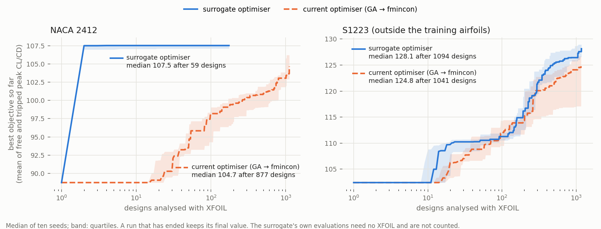

# Surrogate-assisted optimiser: benchmark

`optimize_airfoil(..., 'Algorithm', 'surrogate')` (see [MATLAB/Optimization](../../MATLAB/Optimization/README.md#surrogate-assisted-search))
against the current optimiser (GA → fmincon), on six airfoils that the surrogate never saw in training.

## Task and setup

- Objective: the mean of the peak CL/CD with free transition (Ncrit 9) and with transition tripped at 5 %
  chord, Re = 10⁶ (the "robusttrip" formulation of the population study). All limits as in the
  population study: t/c not below the original, |CM| at 0° at most 0.05 above the original, curvature
  limits, CST order 6, every coefficient changed by at most 0.08.
- Airfoils: NACA 2412, NACA 0012, NACA 4415, Clark Y, SD7062 and S1223; three seeds each.
- Surrogate: an ensemble of five neural networks (three hidden layers, 128-128-64, ReLU) that predicts
  the objective from the 14 CST coefficients. It was trained on 10 341 designs that XFOIL analysed
  during the robusttrip runs of the population study, on its other 24 airfoils.
- Warm start: the robusttrip optima of the three training airfoils whose CST fits are closest to the
  airfoil.
- Trust limits, from the training airfoils only: distance from the nearest training airfoil at most
  5.78 (in standardised CST units, the largest such distance between training airfoils); median
  prediction error on the candidates at most 6.2 % (90th percentile of a grouped cross-validation); at
  least half of the candidates with a usable polar.
- The values below are the objectives that the optimiser recorded with XFOIL, with the friction floor.
  The final designs have not yet been put through the full re-analysis of the population study.

All runs: [benchmark_runs.csv](benchmark_runs.csv), with the XFOIL-analysed designs, run time, trust
check and code version of every run.

## Results: final version against the current optimiser

| Airfoil | Original | Surrogate optimiser, seeds 1 / 2 / 3 | Mean | XFOIL designs (mean) | Time (mean) | Current optimiser, seeds 1 / 2 / 3 | Mean | XFOIL designs (mean) | Time (mean) |
|---|---:|---:|---:|---:|---:|---:|---:|---:|---:|
| NACA 2412 | 88.7 | 107.6 / 106.8 / 108.2 | 107.5 | 84 | 12 min | 105.5 / 103.3 / 106.8 | 105.2 | 915 | 41 min |
| NACA 0012 | 69.9 | 98.7 / 98.4 / 99.2 ¹ | 98.8 | 328 | 22 min | 84.8 / 94.2 / 97.9 | 92.3 | 890 | 41 min |
| NACA 4415 | 89.8 | 108.4 / 108.9 / 108.2 | 108.5 | 58 | 4 min | 108.8 / 106.1 / 108.5 | 107.8 | 982 | 41 min |
| Clark Y | 96.8 | 125.2 / 125.0 / 125.4 | 125.2 | 139 | 11 min | 124.1 / 123.9 / 122.3 | 123.4 | 1018 | 51 min |
| SD7062 | 99.7 | 119.9 / 118.4 / 120.4 | 119.6 | 54 | 6 min | 120.3 / 119.5 / 120.4 | 120.0 | 1063 | 47 min |
| S1223 | 102.4 | 128.3 / 130.1 / 126.5 ¹ | 128.3 | 1096 | 52 min | 126.8 / 126.9 / 123.4 | 125.7 | 1122 | 51 min |

¹ Not trusted; the result comes from the fallback to the genetic algorithm with XFOIL.

The final version (v5, below) gives these results unchanged: it only makes the trust check stricter for
airfoils beyond the distance limit, and the S1223 runs above were not trusted anyway.

- The surrogate was trusted in 14 of 18 runs. In those, it needed 4 to 22 times fewer XFOIL analyses
  than the current optimiser with the same seed. Its result was higher in 9 of the 14 runs and at most
  1.1 lower in the other 5 (NACA 4415 seeds 1 and 3, SD7062 all three seeds).
- S1223 lies far outside the training airfoils (distance 7.48 against the limit 5.78; the other five are
  at 1.17 to 2.78). The check rejects the surrogate in all three seeds, and the fallback then gives a
  result similar to the current optimiser, at a similar cost.
- NACA 0012 seed 3: only a third of the candidates gave a usable polar, so the check rejected the
  surrogate and the run fell back.

## How the method developed

Mean of three seeds: objective / XFOIL-analysed designs. The versions are commits of
`optimize_airfoil.m`.

| Airfoil | v1: no check (d9f9e25) | v2: check + fallback (b709ef0) | v3: + closed loop (23285ba) | v4: fallback restart (021a63d) | Current optimiser |
|---|---:|---:|---:|---:|---:|
| NACA 2412 | 107.5 / 84 | 107.5 / 84 | 107.5 / 84 | 107.5 / 84 | 105.2 / 915 |
| NACA 0012 | 98.3 / 96 | 98.6 / 338 | 98.6 / 317 | 98.8 / 328 | 92.3 / 890 |
| NACA 4415 | 108.5 / 58 | 108.5 / 58 | 108.5 / 58 | 108.5 / 58 | 107.8 / 982 |
| Clark Y | 125.2 / 139 | 125.2 / 139 | 125.2 / 139 | 125.2 / 139 | 123.4 / 1018 |
| SD7062 | 119.5 / 45 | 119.9 / 977 | 119.6 / 54 | 119.6 / 54 | 120.0 / 1063 |
| S1223 | 110.2 / 76 | 126.1 / 1109 | 118.5 / 1153 | 128.3 / 1096 | 125.7 / 1122 |

- **v1** trusted the surrogate everywhere. On S1223 it predicted 161 where XFOIL gave 110, and the
  result stayed 15.5 below the current optimiser.
- **v2** added the trust check and the fallback. It fixed S1223, but SD7062 fell back in every seed
  (about 980 designs) although v1 was already close there.
- **v3** added the closed loop. SD7062 now passes the check after one correction round (54 designs). On
  S1223 the loop lowered the error (seed 1: 45 % → 22 %) but never passed the check. Its candidates,
  all close to one design, then filled the whole starting population of the fallback, which ended
  lower (111.9 and 118.2 in seeds 2 and 3).
- **v4** starts the fallback from the first-search candidates and the usual starting population. Only
  the four runs that fall back (S1223 seeds 1 to 3, NACA 0012 seed 3) were run again; the other 14
  never reach the fallback, so v4 gives them the v3 result.
- **v5** (be7baa1) applies the distance limit in every round of the closed loop, not only to the first
  batch. In v4, S1223 seed 4 passed the check after one correction round (median error 4.3 %): the
  corrected surrogate agreed with XFOIL near one design, but that design was poor (111.0), and the
  fallback never ran. With v5 the run falls back and gives 126.8. An airfoil beyond the distance limit
  therefore always falls back. The 18 runs above are unchanged.

## Ten seeds: NACA 2412 and S1223

Seeds 4 to 10 were added for the two airfoils at the ends of the range: one inside the training
airfoils and one outside. Surrogate runs from seed 4 on use v5 (NACA 2412 seed 4: v4, the same code
path inside the distance limit); the current optimiser is unchanged.

| Airfoil | Optimiser | Mean ± std | Median | Range | XFOIL designs (mean) | Time (mean) |
|---|---|---:|---:|---:|---:|---:|
| NACA 2412 | surrogate | 107.5 ± 0.5 | 107.5 | 106.8 to 108.2 | 76 | 12 min |
| NACA 2412 | current (GA → fmincon) | 104.1 ± 2.8 | 104.7 | 98.1 to 106.9 | 921 | 41 min |
| S1223 | surrogate (fallback in all 10) | 126.8 ± 3.8 | 128.1 | 117.2 to 130.1 | 1087 | 49 min |
| S1223 | current (GA → fmincon) | 122.9 ± 6.5 | 124.8 | 112.8 to 130.4 | 1054 | 46 min |

Median of the ten seeds (band: quartiles) of the best valid objective so far against the number of
designs analysed with XFOIL ([convergence_ten_seeds.csv](convergence_ten_seeds.csv)); the surrogate's own
evaluations need no XFOIL and are not counted. On NACA 2412 the first candidate of the surrogate is
within 0.4 of the run's final value in every seed. On S1223, where every run falls back, the median of
the surrogate optimiser is ahead from about 12 to 75 designs, slightly behind at 100 to 150, and ahead
from about 200 designs on.

Mann-Whitney U test (two-sided) of the two optimisers: NACA 2412 p = 0.0004; S1223 p = 0.19. On NACA
2412 the surrogate optimiser is better, with a twelfth of the XFOIL analyses and a sixth of the spread.
On S1223 it rejects itself in every seed, and the fallback is no worse than the current optimiser.
He et al. (2019) find that RANS optimisations reach the same optimum from any start; with XFOIL the
current optimiser ends anywhere between 98.1 and 106.9 on NACA 2412, so a single run says little about it.

## Optimiser comparison at equal budget (NACA 2412, peak CL/CD, free transition)

The task of the comparison in [results/paper](../paper/README.md#optimiser-comparison-at-equal-budget-naca-2412-peak-clcd):
global search only, population 40, 15 generations. GA, particle swarm and Bayesian optimisation were
run again with the current code (021a63d, friction floor). The surrogate uses a second model trained
on the free-transition peak runs of the population study (43 737 designs of the 24 training airfoils;
trust limits from those airfoils: distance 5.15, median error 7.0 %). All runs:
[equal_budget.csv](equal_budget.csv).

| Search | Best objective, seeds 1 / 2 / 3 | Mean ± std | XFOIL-analysed designs (mean) | Time (mean) |
|---|---:|---:|---:|---:|
| surrogate | 139.3 / 139.8 / 141.9 | 140.3 ± 1.4 | 13 | 4 min |
| genetic algorithm | 127.7 / 133.4 / 128.4 | 129.9 ± 3.1 | 359 | 10 min |
| particle swarm | 128.6 / 123.1 / 126.5 | 126.1 ± 2.8 | 79 | 3 min |
| Bayesian optimisation | 134.3 / 131.0 / 132.7 | 132.7 ± 1.6 | 648 | 92 min ² |

² Seeds 1 and 2; the run time of seed 3 includes a standby of the laptop.

- GA and particle swarm reproduce the published values exactly. Bayesian optimisation does not (published
  128.0 / 126.2 / 130.4), because its parallel evaluations are not repeatable.
- The surrogate was trusted in all three seeds. Its final population held 20, 5 and 4 distinct
  candidates, which were analysed with XFOIL; the counts in the table also include the three other
  XFOIL analyses of every run.

## Comparison with Xoptfoil2 on the six airfoils (peak CL/CD, free transition)

Xoptfoil2 2.0.0 can trip transition only for a whole run and has no peak objective, so it cannot run the
free-plus-tripped task above. It was given the closest task it can run: maximum CL/CD at three lift
coefficients around the peak of the original (CL at the peak −0.2, at the peak, +0.2; weights 0.25 /
0.5 / 0.25), free transition, Re = 10⁶. It starts from the same CST fit of the original as
`optimize_airfoil`, may have as many curvature reversals per surface as the curvature limits allow
(at most 2, the largest value it accepts), and keeps the thickness of the original (a thickness
target: its minimum-thickness limit alone was not enforced on the result). It uses its default 6 Bezier
points per surface, 7 for S1223, where it rejects its 6-point fit of the seed. The GA designs are the
peak runs of the population study; the surrogate (v5) uses the free-transition model. Every design was
analysed in the same way (XFOIL with the friction floor and the rule against false solutions). All
designs: [peak_compare.csv](peak_compare.csv).

| Airfoil | Original | GA → fmincon | Surrogate | Xoptfoil2 |
|---|---:|---:|---:|---:|
| NACA 2412 | 104.6 | 139.4 (137.7 to 141.8) | 143.0 (142.9 to 143.1) | 154.9 (143.0 to 161.0) ³ |
| NACA 0012 | 76.5 | 116.1 (111.1 to 118.9) | 124.1 (123.7 to 124.4) | 108.2 (91.1 to 122.8) |
| NACA 4415 | 121.6 | 143.7 (142.4 to 145.7) | 145.9 (145.4 to 146.3) | 143.2 (142.0 to 145.5) ³ |
| Clark Y | 114.8 | 171.7 (170.3 to 172.6) | 171.3 (171.3 to 171.4) | 137.7 (128.0 to 145.6) |
| SD7062 | 120.3 | 165.9 (163.4 to 168.0) | 165.8 (163.7 to 166.9) | 158.4 (154.6 to 165.9) ³ |
| S1223 | 120.9 | 170.4 (167.1 to 175.5) | 179.5 (167.1 to 185.9) | 142.7 (138.6 to 145.5) |

Peak CL/CD, mean of three runs (range). ³ Xoptfoil2 has no pitching-moment limit. Designs beyond the
limit of `optimize_airfoil` (the magnitude of CM at 0° at most 0.05 above the original's): NACA 2412 runs 2 and 3
(CM −0.120 and −0.117; the run within the limit gives 143.0), NACA 4415 run 1, SD7062 all three runs.

- The surrogate optimiser has the highest mean on NACA 0012, NACA 4415 and S1223, is level with the GA
  on Clark Y and SD7062, and on NACA 2412 is above the GA and level with the one Xoptfoil2 run within the
  moment limit. Its spread between runs is the smallest on five airfoils; on S1223, where it falls back
  to the genetic algorithm, it is the largest (167.1 to 185.9). It took 4 to 32 minutes per run on
  average, the GA 28 to 130.
- Xoptfoil2 is the fastest (1 to 8 minutes on average) but varies more between runs and is clearly lower
  on Clark Y and S1223. It optimises CL/CD at three lift coefficients, not the peak itself.

## Final designs through the safeguards of the population study

All final designs of the benchmark above (surrogate optimiser and current optimiser; ten seeds for NACA
2412 and S1223, three for the others: 32 each) were analysed again with the code of the population study:
[safeguards/](safeguards/), one folder per optimiser, with the same files as
[results/population](../population/README.md).

- **No false XFOIL solutions.** `xfoil_sensitivity_check.m`: every one of the 64 designs reproduces its
  recorded objective, and with the friction floor the exact and rounded coordinates at 160 and 200 panel
  nodes agree within 0.27 % (surrogate) and 0.23 % (current optimiser). No design meets the rerun rule.
- **The seven conditions** (`collect_population_results.m`; consensus polars). Median gain in peak CL/CD
  over the original, all 32 designs of each optimiser:

| Condition | Surrogate optimiser | Current optimiser |
|---|---:|---:|
| design (Ncrit 9, Re = 10⁶) | +36.1 % | +31.9 % |
| Ncrit 5 / 7 / 11 | +40.7 / +39.5 / +34.3 % | +30.5 / +35.1 / +29.1 % |
| Re = 0.5 × 10⁶ / 2 × 10⁶ | +30.3 / +44.6 % | +24.3 / +35.8 % |
| tripped at 5 % chord | +3.4 % | +2.8 % |
| designs below the original when tripped | 14 of 32 | 11 of 32 |

Mean over the seeds, peak CL/CD with free / tripped transition (in brackets: designs below the original
when tripped):

| Airfoil | Original | Surrogate optimiser | Current optimiser |
|---|---:|---:|---:|
| NACA 2412 | 104.6 / 73.1 | 137.6 / 77.4 (0 of 10) | 132.9 / 75.4 (0 of 10) |
| NACA 0012 | 76.5 / 62.2 | 121.9 / 75.8 (0 of 3) | 110.8 / 73.9 (0 of 3) |
| NACA 4415 | 121.6 / 61.1 | 143.1 / 74.0 (0 of 3) | 142.0 / 73.6 (0 of 3) |
| Clark Y | 114.8 / 80.0 | 171.4 / 79.0 (3 of 3) | 168.3 / 78.8 (3 of 3) |
| SD7062 | 120.3 / 77.6 | 161.7 / 77.6 (1 of 3) | 162.0 / 78.2 (1 of 3) |
| S1223 | 120.9 / 85.0 | 173.0 / 80.6 (10 of 10) | 162.7 / 83.2 (7 of 10) |

- With free transition the surrogate designs gain more than those of the current optimiser at every
  condition. With tripped flow the two are close. On Clark Y and S1223, the two airfoils with the best
  tripped values of the six, most designs of both optimisers are below the original when tripped: the
  objective is the mean of the two values, so it can trade a small tripped loss for a large free gain.
- `summary.csv` and `robustness_summary.csv` take seed 1 only, as in the population study; the tables
  above use all seeds (`conditions.csv`).

## Still running

- A RANS check (Fluent, the models and angles of the [CFD design study](../cfd/README.md#design-study))
  of the surrogate designs of NACA 2412 and NACA 0012 (seed 3 of each, the best by the objective; for
  NACA 0012 the trust check rejected the surrogate, so this design comes from the fallback) and of NACA
  0012 itself. The coordinates are in [airfoils/](airfoils/).
